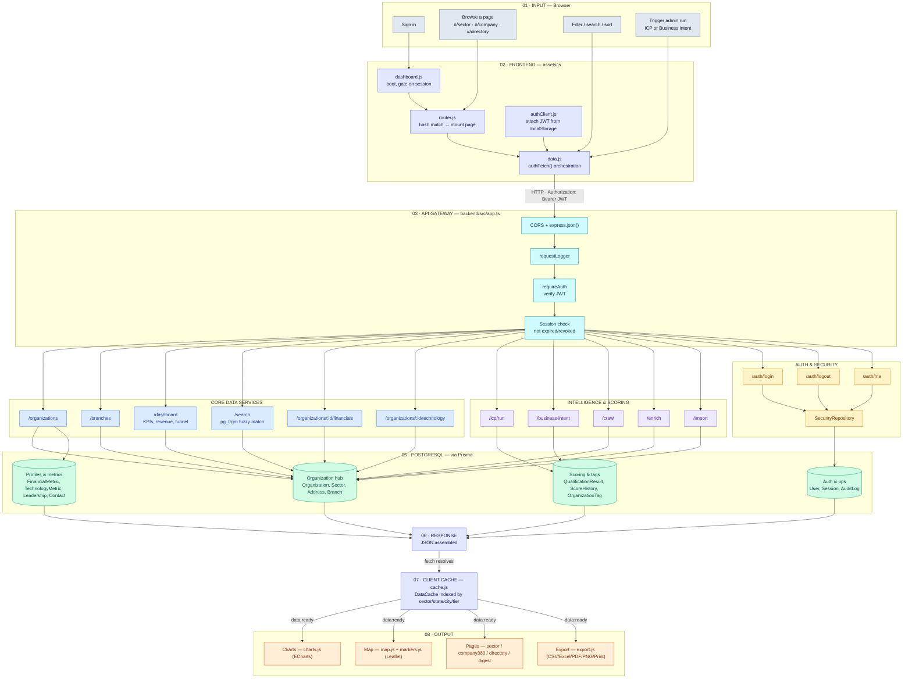
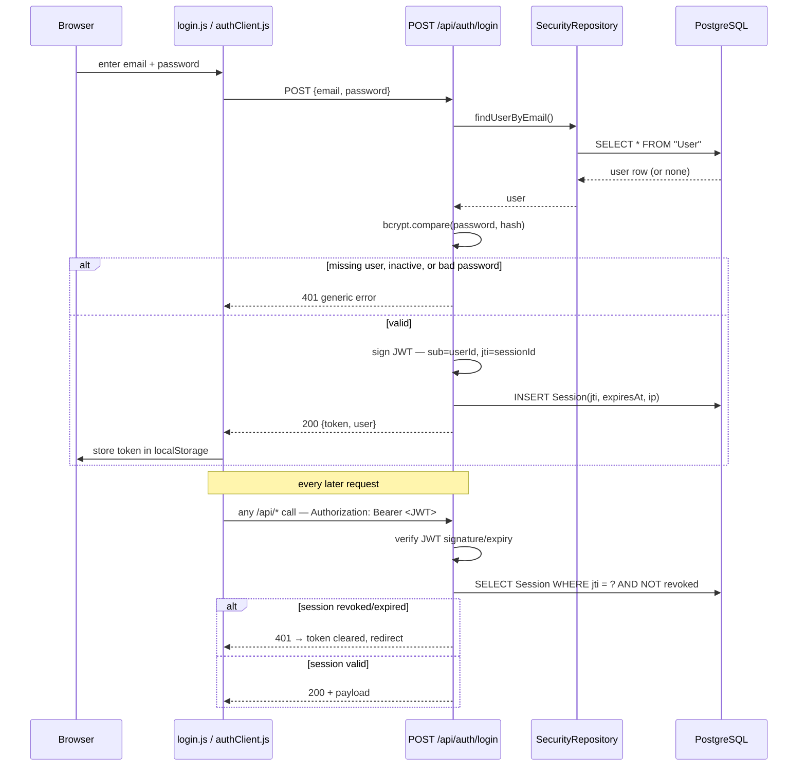
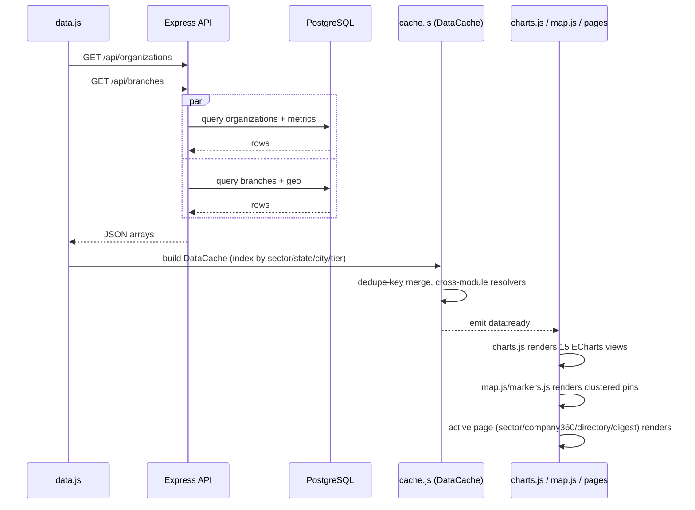
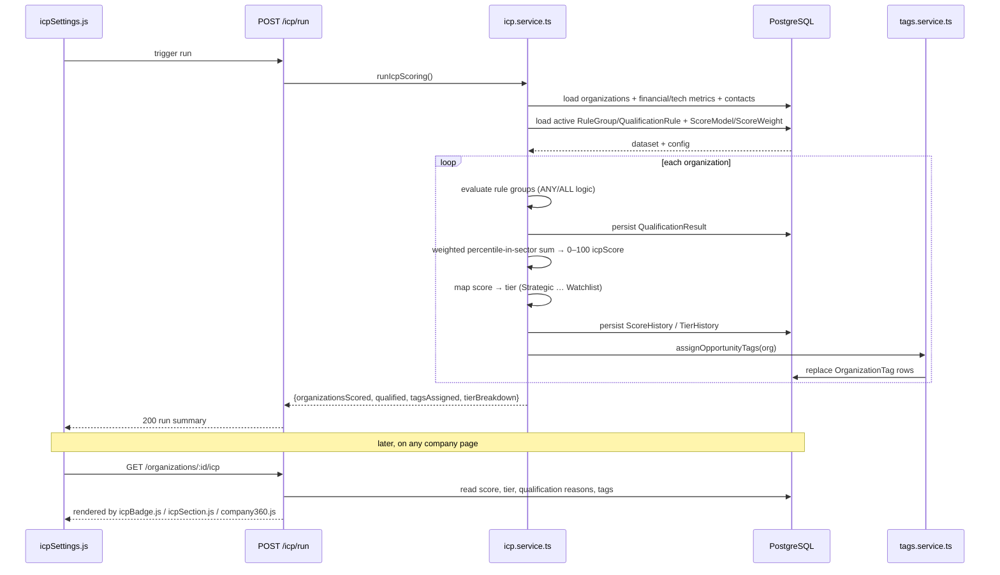
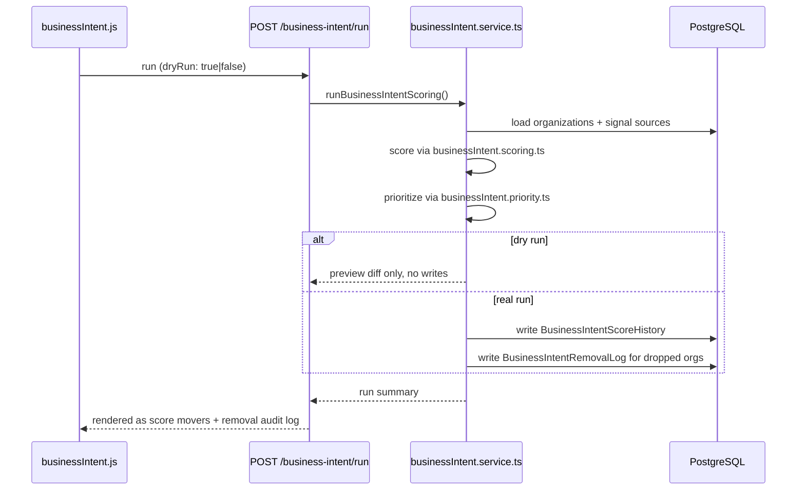
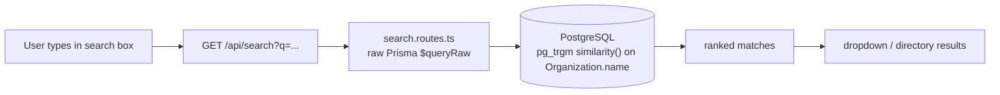
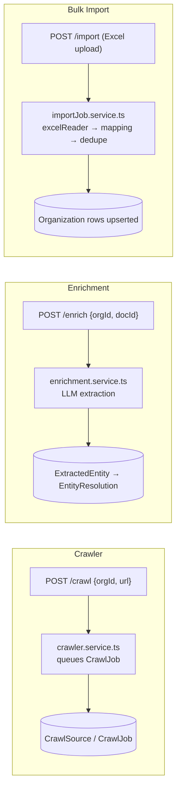

# ChanakyaIQ Platform — Full Pipeline

This document maps every stage the live platform goes through: browser input → frontend →
Express API → service/repository layer → PostgreSQL → response → client cache → rendered
output (charts, map, pages, export). It also breaks out the individual pipelines that don't
show up in the top-level flow: login/session, ICP scoring, Business Intent scoring, search,
crawler, enrichment, and bulk import.

Edit this file directly — it's plain Markdown with [Mermaid](https://mermaid.js.org/) diagrams,
so it renders on GitHub, in most editors, and stays in version control with the code it
describes. If a route, service, or table changes, update the relevant section here in the
same PR.

---

## 1. End-to-end pipeline

---

## 2. Login & session

The JWT proves who a user *claims* to be; the database `Session` row is the actual source of
truth for whether that claim is still valid — logout flips one flag and every future request
is rejected immediately, regardless of what the token itself says.

**Files:** [backend/src/middleware/auth.ts](backend/src/middleware/auth.ts) ·
[backend/src/modules/auth/](backend/src/modules/auth/) ·
[backend/src/modules/security/security.repository.ts](backend/src/modules/security/security.repository.ts) ·
[assets/js/data/authClient.js](assets/js/data/authClient.js)

---

## 3. Dashboard data fetch & render

The default page load: two parallel API calls build the entire in-memory dataset the rest of
the UI filters and renders against — no per-page refetching after that.

**Files:** [assets/js/data/data.js](assets/js/data/data.js) ·
[assets/js/data/cache.js](assets/js/data/cache.js) ·
[assets/js/charts/charts.js](assets/js/charts/charts.js) ·
[assets/js/map/map.js](assets/js/map/map.js)

---

## 4. ICP scoring run

Manual, admin-triggered batch job (no scheduler) that re-scores every organization against
whatever rules and weights are currently configured in the database.

**Files:** [backend/src/modules/icp/icp.service.ts](backend/src/modules/icp/icp.service.ts) ·
[backend/src/modules/icp/tags.service.ts](backend/src/modules/icp/tags.service.ts) ·
[backend/src/modules/icp/icp.repository.ts](backend/src/modules/icp/icp.repository.ts) ·
[assets/js/components/icpSection.js](assets/js/components/icpSection.js) ·
[assets/js/utils/icpBadge.js](assets/js/utils/icpBadge.js)

---

## 5. Business Intent scoring

Similar shape to ICP scoring but classifies organizations by intent signals, and supports a
dry-run mode before committing changes.

**Files:** [backend/src/modules/businessIntent/businessIntent.service.ts](backend/src/modules/businessIntent/businessIntent.service.ts) ·
[assets/js/pages/businessIntent.js](assets/js/pages/businessIntent.js)

---

## 6. Search

**Files:** [backend/src/modules/search/](backend/src/modules/search/)

---

## 7. Background jobs — crawler, enrichment, import

These three don't run on the request/response cycle above; they're longer-running jobs
kicked off from an admin action and polled or checked later.

**Files:** [backend/src/modules/crawler/](backend/src/modules/crawler/) ·
[backend/src/modules/enrichment/](backend/src/modules/enrichment/) ·
[backend/src/modules/import/](backend/src/modules/import/)

---

## 8. Module reference

| Route base | Module | Service → Repository | Key tables touched |
|---|---|---|---|
| `/auth` | auth | `auth.routes.ts` → `SecurityRepository` | User, Session |
| `/organizations` | organizations | `OrganizationsRepository` + `organizations.mapper.ts` | Organization, Sector, Address |
| `/branches` | branches | `BranchesRepository` | Branch, City, State |
| `/organizations/:id/financials` | financials | `FinancialsRepository` | FinancialMetric, FinancialProfile |
| `/organizations/:id/technology` | technology | `TechnologyRepository` | TechnologyMetric, TechnologyProfile |
| `/dashboard` | dashboard | `DashboardRepository` | aggregates across Organization |
| `/search` | search | raw `$queryRaw` (pg_trgm) | Organization |
| `/icp` | icp | `icp.service.ts` + `tags.service.ts` → `icp.repository.ts` | QualificationResult, ScoreHistory, OrganizationTag |
| `/business-intent` | businessIntent | `businessIntent.service.ts` → `businessIntent.repository.ts` | BusinessIntentScoreHistory, BusinessIntentRemovalLog |
| `/crawl` | crawler | `crawler.service.ts` → `crawler.repository.ts` | CrawlSource, CrawlJob |
| `/enrich` | enrichment | `enrichment.service.ts` → `enrichment.repository.ts` | EnrichmentJob, ExtractedEntity |
| `/import` | import | `importJob.service.ts` → `excelReader.ts`/`mapping.ts`/`dedupe.ts` | Organization (bulk upsert) |

## 9. Frontend routing

| Route | Page file | Shows |
|---|---|---|
| `/` | `home.js` | Landing page (persistent) |
| `/login` | `login.js` | Login overlay |
| `/sector/:key` | `sector.js` | Sector KPIs, maturity, top companies |
| `/company/:key` | `company360.js` | Single-company profile: financials, leadership, ICP fit, tech stack |
| `/directory` | `companyDirectory.js` | Full exportable company table |
| `/digest` | `digest.js` | Weekly digest: score movers, accounts to action |
| `/settings/icp` | `icpSettings.js` | Edit ICP rule thresholds (GET/PATCH `/api/icp/rules`) |
| `/settings/business-intent` | `businessIntent.js` | Trigger BI scoring runs, view removal log |

---

## Keeping this in sync

Update the relevant section (and its Mermaid diagram) whenever you: add/rename a route, add a
Prisma model, change the auth flow, or change what a scoring run computes. The diagrams are
plain text — edit the node labels and arrows directly, no diagram tool required.
