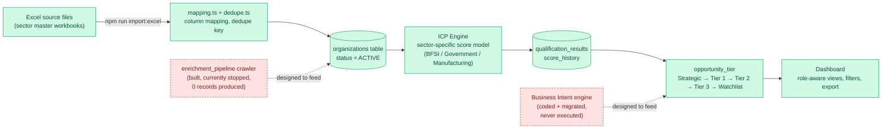
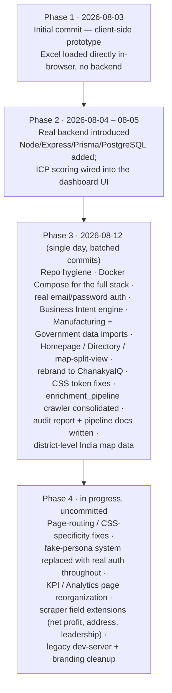

# ChanakyaIQ

*"Intelligence that closes deals."*

**Concept Note** — ESDS Software Solution Ltd. · Internal

---

## 1. Problem Statement

Enterprise account targeting for ESDS's BFSI go-to-market motion started as a manual,
spreadsheet-based exercise: two "Master BFSI" Excel workbooks, over 20,000 raw company rows,
no shared source of truth, and no systematic way to tell which of those companies were actually
worth pursuing. Every team — sales, BDR, solutions, marketing — worked from its own copy of the
sheet, with no consistent qualification logic, no way to see how an account's opportunity
changed over time, and no mechanism to prioritize a sales rep's day beyond whatever order the
spreadsheet happened to be sorted in.

The platform's own first build (commit `aa1205e`, 2026-08-03) literally *was* that spreadsheet
made interactive — a zero-backend, client-side dashboard that loaded the same Excel files
directly into the browser. That was a real step forward (one map, one set of filters, one
company view instead of a dozen sheet tabs) but it inherited the underlying problem: data lived
in files, not a database, so there was still no persistent scoring, no audit trail of what
changed, and no way for the data to be enriched or re-qualified without re-exporting a new Excel
file by hand.

**In short, the problem this platform exists to solve:** enterprise targeting data was scattered,
stale, and un-scored, and prioritization depended entirely on individual judgment rather than a
consistent, explainable model.

---

## 2. Objective

ChanakyaIQ (formerly "ESDS BFSI Geo Intelligence") is a database-backed platform that:

1. **Imports and consolidates** organization data — financials, technology spend, leadership,
   addresses, branch networks — into a single PostgreSQL database via a Node/Express/Prisma
   backend, replacing the Excel-in-browser prototype.
2. **Qualifies and scores** every organization against a configurable Ideal Customer Profile
   (ICP) engine: sector-specific rule sets and weighted scoring models decide who qualifies and
   how strong the fit is.
3. **Surfaces prioritized accounts** through a role-aware web dashboard — an executive view, a
   territory/"my accounts" view, a whitespace (unassigned high-fit accounts) view, sector
   deep-dives, and a full exportable company directory — all reading from the same scored dataset.

### Current real scope (verified against the live database, 2026-08-17)

| Sector | Organizations |
|---|---|
| Manufacturing | 552 |
| Government | 478 |
| BFSI | 294 |
| **Total live** | **1,324** |

The schema defines **8 sectors** (BFSI, Manufacturing, Government, Healthcare, Education,
Telecom, Retail, Energy); only the first three currently hold data. Each of the three live
sectors has its own ICP scoring model (`BFSI Default ICP Model`, `Government Default ICP Model`,
`Manufacturing Default ICP Model`), and scoring has actually been run — the database holds 2,987
recorded qualification evaluations and a real tier distribution:

| Opportunity Tier | Organizations |
|---|---|
| Strategic | 45 |
| Tier 1 | 69 |
| Tier 2 | 70 |
| Tier 3 | 109 |
| Watchlist | 1,031 |

Average ICP score across all organizations is **18.7 / 100** — a wide, mostly-unqualified spread
is expected here, since the ICP engine is deliberately scoring the *entire* imported universe,
not a pre-filtered lead list; the tiering is what turns that wide spread into something a sales
team can act on.

---

## 3. Future Scope

Described honestly, against what is actually running today — not what was originally planned.

**Crawler / enrichment pipeline — in progress, not yet producing real data.**
A Python microservice pipeline (`enrichment_pipeline/` — seed loader, crawler, translator,
extractor, ICP scorer, DB writer, logger, orchestrator, coordinated over Redis Streams) exists
and has been consolidated as the one active build, replacing an earlier, parallel Python package
(`pipeline/`) that is now formally archived. The crawler container is currently **stopped** — it
was shut down after it caused a resource-contention incident that starved the main application's
database — and its own tracking table shows **zero completed enrichment records** to date. Its
practical blocker is data coverage, not code: only a small fraction of the organizations on file
have a website domain recorded, and the crawler's discovery stage depends on one. This is real,
running infrastructure that has not yet been proven end-to-end, not a finished capability.

**Additional sectors — schema-ready, data not collected.** Healthcare, Education, Telecom,
Retail, and Energy are already defined as sectors in the database and require no schema changes
to onboard — only a data source and an import run, the same path Manufacturing and Government
already went through.

**MEDDPICC / Business Intent layer — built and migrated, never executed.** A full
qualification-intent engine (`businessIntent.service.ts` and related files) that scores
organizations against MEDDPICC-style signals and can archive low-intent accounts is coded,
tested, and its database migration is applied — the tables (`business_intent_score_history`,
`business_intent_removal_log`) exist. It has simply never been run: every one of the 1,324
organizations currently sits at `business_intent_classification = 'Not Scored'`. Two of the
signal letters in the original design (pain-point and cloud-provider data) have no real data
source yet, so the classification thresholds were already recalibrated down from the original
spec — worth validating against a real run before this is turned on for real decisions.

**Multi-user roles — authentication is real, authorization is not yet enforced.** Real
email/password login (bcrypt + JWT, session table) replaced the earlier no-auth API and is in
active use (79 real login sessions recorded). Four roles are seeded in the database — Admin,
Analyst, Sales, Viewer — but the `role_permissions` table that would make those roles actually
restrict what a user can see or do is currently empty: every logged-in user has the same access
today, regardless of role. Only 2 real user accounts exist. Role-based access control is schema-
ready, not yet built.

**Contact / leadership depth.** The `contacts` table is empty across all 1,324 organizations
(119 rows exist in the separate `leadership_profiles` table, i.e. named executives, but no
verified contact records). The ICP engine's "Leadership & Contact Availability" scoring
component is structurally capped as a result — a known, honest limitation rather than a bug.

**Pagination / scaling.** The frontend currently loads the full dataset into an in-memory,
indexed client-side cache on boot — workable at the current 1,324-organization scale, and this
is the piece that would need attention first if the live sectors grow substantially or all 8
sectors are populated.

---

## 4. Pipeline

The path data actually takes today, from source file to a scored account on someone's screen:

Green stages are live and running against real data today. The two red, dashed stages
(crawler-based enrichment and Business Intent scoring) are fully built and wired into the schema
but not yet contributing to what a user sees on the dashboard.

---

## 5. Technical Architecture

| Layer | Technology | Notes |
|---|---|---|
| Frontend | Vanilla JavaScript (ES modules), no build step | Served as static files by nginx 1.27-alpine |
| Charts | Apache ECharts 5.5.1 | CDN-loaded on demand |
| Map | Leaflet 1.9.4 + leaflet.markercluster 1.5.3 + leaflet.heat 0.2.0 | CDN-loaded on demand |
| Export | SheetJS (xlsx) 0.20.3, jsPDF 2.5.2, html2canvas 1.4.1 | CDN-loaded on demand |
| Backend | Node.js 24, Express 4.21, TypeScript 5.7 | Runs via `tsx` directly, no separate compile step |
| ORM / Migrations | Prisma 6.3 (`@prisma/client`) | 60 models defined in `schema.prisma` |
| Validation | Zod 3.24 | Request-body validation |
| Auth | bcryptjs 3.0 (password hashing), jsonwebtoken 9.0 | JWT + DB-backed session table (revocable) |
| Database | PostgreSQL 18 (alpine) | Main application database |
| Enrichment pipeline | Python 3.12 | 8 microservices: seed_loader, crawler, translator, extractor, icp_scorer, db_writer, logger, orchestrator |
| Pipeline messaging | Redis 7 (alpine), `redis` 5.0.8 client | Redis Streams connect the microservices |
| Pipeline libraries | pydantic 2.9.2, httpx 0.27.2, BeautifulSoup4 4.12.3, lxml 5.3.0, Camoufox 0.4.11 | Camoufox is a stealth headless-Firefox browser used by the crawler |
| Pipeline database | PostgreSQL 16 (alpine) | Separate instance, isolated from the main app database |
| Containerization | Docker Compose | Two separate compose projects: the main app stack (postgres/backend/frontend) and the enrichment pipeline stack |

---

## 6. Management / Project Flow

Reconstructed from the real commit history (`git log`), not an idealized retelling. The project's
committed history spans 14 commits from 2026-08-03 to 2026-08-12; a further, currently
uncommitted round of fixes and cleanup is in progress as of this note (2026-08-17).

**Status today:** Phases 1–3 are committed and represent the working, live application described
in Sections 2, 4, and 5 above. Phase 4 is real, in-progress work sitting in the working tree —
not yet committed — consistent with this note's "describe it accurately, don't oversell"
instruction: nothing in Phase 4 is claimed as shipped until it is.

---

*Numbers in this note were pulled directly from the live database and codebase on 2026-08-17 —
organization/sector counts, tier distribution, table row counts, container status, dependency
versions, and commit history are not estimates.*
